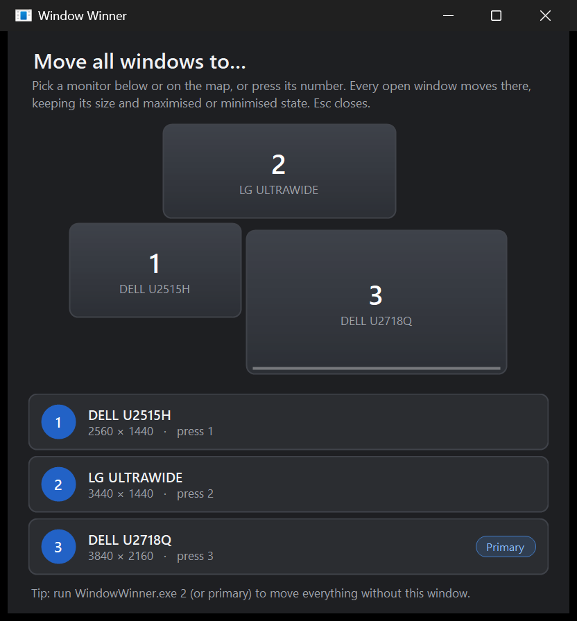

# Window Winner

Bring every open window onto one monitor with a single click.

Use it when windows are stranded on a screen you've switched off, when you undock a laptop, or when you just want everything in front of you.



## Features

- **Map of your monitors** laid out the way they are physically arranged, with each monitor's model name (e.g. *DELL U2718Q*).
- **One click, or one key.** Click a monitor on the map or in the list, or press its number.
- **Windows keep their state.** Maximised windows stay maximised and minimised windows stay minimised. Normal windows keep their size and relative position, and shrink only if they wouldn't fit.
- **Works with mixed scaling.** Positions are correct when monitors use different DPI settings.
- **Picks up display changes:** plugging in or unplugging a monitor updates the list live.
- **Command-line mode** for shortcuts and hotkeys, with no window shown.
- **A single small `.exe`** that needs no install or runtime download. It uses the .NET Framework 4.8 built into Windows 10 and 11.

## Download

Get `WindowWinner.exe` from the [latest release](../../releases/latest), or use the copy in this repository. Put it anywhere and run it.

Windows SmartScreen may warn about an unsigned app the first time. Choose **More info → Run anyway**.

## Usage

```
WindowWinner.exe            open the picker
WindowWinner.exe 2          move every window to monitor 2, no UI
WindowWinner.exe primary    move every window to the primary monitor, no UI
```

Monitors are numbered left to right (then top to bottom), as shown in the picker. This may differ from the numbering in Windows Display Settings. Run `WindowWinner.exe help` to see the current numbering.

To get a hotkey, create a desktop shortcut to `WindowWinner.exe primary`, open its **Properties**, and set a **Shortcut key**.

### Which windows move

The same windows that appear in Alt+Tab. The taskbar, desktop, tool palettes, and hidden or background windows are left alone.

Windows belonging to programs running **as administrator** can't be moved by a normal program; Windows blocks it. The picker tells you how many it couldn't move. Run Window Winner as administrator to move those too.

## Building from source

There's nothing to install. The C# compiler ships with Windows:

```
C:\Windows\Microsoft.NET\Framework64\v4.0.30319\csc.exe /codepage:65001 /target:winexe /optimize /out:WindowWinner.exe WindowWinner.cs
```

Everything is in [`WindowWinner.cs`](WindowWinner.cs). It's a WinForms app using a few Win32 calls: `EnumWindows`, `Get/SetWindowPlacement`, `EnumDisplayMonitors`, and `QueryDisplayConfig` for monitor names. The code is limited to C# 5 so it builds with that compiler.
